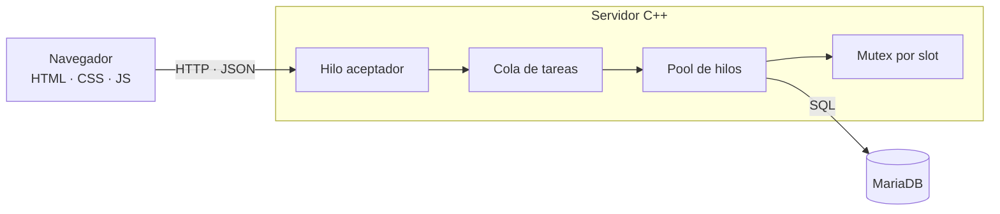

# Gestor de turnos para servicios de salud

Sistema cliente-servidor para reservar, consultar y cancelar citas médicas desde múltiples clientes simultáneos, sin dobles reservas. Proyecto Integrador de **Programación Concurrente** (UVM Campus San Rafael, Ingeniería en Sistemas Computacionales), alineado al **ODS 3, meta 3.8**: acceso a servicios de salud esenciales de calidad.

> **Estado:** en desarrollo. Los comandos y endpoints descritos son la estructura objetivo y se irán habilitando por sprint (ver [Roadmap](#roadmap)).

## El problema de concurrencia

Dos pacientes ven libre el mismo horario y presionan «Reservar» al mismo tiempo. Sin control, ambos hilos leen `estado = libre` y ambos escriben la cita: dos citas para un solo slot (*check-then-act*). El sistema lo resuelve en tres capas:

| Capa | Mecanismo |
|---|---|
| Memoria del servidor | Mutex por slot, con orden de bloqueo fijo para evitar deadlocks |
| Atención de peticiones | Pool de hilos con cola de tareas (`mutex` + `condition_variable`) |
| Base de datos | Transacción con `SELECT ... FOR UPDATE` y `UNIQUE` sobre la cita activa del slot |

Resultado esperado: con N clientes disputando el mismo slot, **una** cita confirmada (`201`) y N−1 rechazos (`409`).

## Arquitectura



## Tecnologías

- **C++17** (`std::thread`, `std::mutex`, `std::condition_variable`)
- **cpp-httplib** y **nlohmann/json** (de un solo encabezado, en `third_party/`)
- **MariaDB** (InnoDB) con MariaDB Connector/C
- **Web app** en HTML, CSS y JavaScript
- **Make** para compilar, **Git/GitHub** (Gitflow + Conventional Commits) y **Jira** para Scrum

## Requisitos

- `g++` con soporte de C++17 y `make`
- MariaDB Server y MariaDB Connector/C
- Linux, macOS o Windows con WSL2

En Debian/Ubuntu:

```bash
sudo apt install build-essential mariadb-server libmariadb-dev
```

## Inicio rápido

```bash
git clone https://github.com/<usuario>/gestor-turnos.git
cd gestor-turnos

cp .env.example .env   # y edita las credenciales
make db-init     # crea la base y las tablas (pide la contraseña de MariaDB)
make db-seed     # carga datos de prueba
make run         # compila y arranca el servidor en http://localhost:8080
```

### Comandos de `make`

| Comando | Descripción |
|---|---|
| `make` | Compila servidor y probador de carga (en `build/release/`) |
| `make run` | Compila y ejecuta el servidor |
| `make debug` | Compila con símbolos de depuración |
| `make tsan` | Compila con ThreadSanitizer para detectar carreras de datos |
| `make db-init` / `make db-seed` | Crea el esquema / carga datos de prueba |
| `make clean` | Borra `build/` |
| `make help` | Lista los comandos |

### Configuración

Las credenciales viven en `.env` (copia de `.env.example`), que **no se sube a Git**. `make run` carga ese archivo automáticamente; si ejecutas el binario directamente: `set -a; source .env; set +a; ./build/release/gestor_server`. `make db-init` y `make db-seed` usan el administrador de MariaDB (`DB_ADMIN_USER`, por defecto `root`), no el usuario de la aplicación.

## API REST

| Método | Ruta | Descripción |
|---|---|---|
| `GET` | `/api/medicos` | Lista de médicos |
| `GET` | `/api/medicos/{id}/slots?fecha=AAAA-MM-DD` | Horarios del médico en una fecha |
| `POST` | `/api/pacientes` | Registra un paciente |
| `POST` | `/api/citas` | Reserva un slot: `201` si se logra, `409` si ya fue tomado |
| `DELETE` | `/api/citas/{id}` | Cancela una cita y libera el slot |
| `GET` | `/api/pacientes/{id}/citas` | Citas de un paciente |
| `POST` | `/api/medicos` | Registra un médico |
| `POST` | `/api/medicos/{id}/slots` | Genera slots de agenda |
| `GET` | `/api/salud` | Comprueba que el servidor responde |
| `GET` | `/api/agenda?fecha=AAAA-MM-DD` | Agenda del día |

La especificación completa está en `docs/api/openapi.yaml` (OpenAPI 3.0).

## Pruebas de carga

```bash
make
./build/release/loadtest --clientes 50 --slot 1
```

Lanza N clientes simultáneos contra el mismo slot y reporta citas creadas, rechazos, throughput y latencia. Para detectar carreras de datos en el servidor: `make tsan` y ejecutar `build/tsan/gestor_server`.

## Estructura del repositorio

```
.
├── Makefile
├── .env.example         # plantilla de configuración (el .env real no se versiona)
├── .gitignore
├── LICENSE              # MIT
├── src/                 # servidor: núcleo concurrente, acceso a datos, API
├── include/             # encabezados propios
├── third_party/         # httplib.h, json.hpp
├── web/                 # cliente web (HTML, CSS, JS)
├── db/                  # schema.sql, seed.sql
├── tests/loadtest/      # probador de carga
├── docs/                # manual técnico, diagramas, OpenAPI
├── README.md
└── CONTRIBUTING.md
```

## Roadmap

| Sprint | Fechas | Foco |
|---|---|---|
| 0 | 24 oct 2026 | Arquitectura, justificación, backlog |
| 1 | 25–26 oct | Base de datos y núcleo concurrente |
| 2 | 27–28 oct | API REST e integración |
| 3 | 29 oct – 18 nov | Web app, pruebas de carga, despliegue y entrega |

## Contribuir

El flujo de ramas (Gitflow) y el formato de commits (Conventional Commits) están en [CONTRIBUTING.md](CONTRIBUTING.md).

## Equipo

- **Desarrollo y Scrum Master:** Axel Flores Teja
- **Product Owner:** César Antonio Ríos Olivares

## Licencia

Proyecto académico publicado bajo [MIT](LICENSE).
